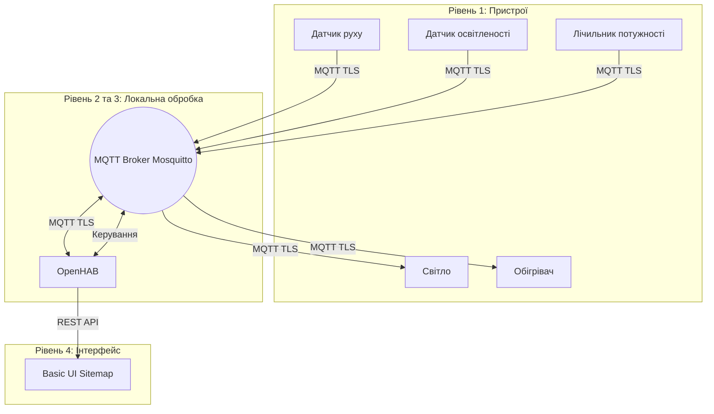

# Модульний контроль 1: Вступ до IoT

Варіант 1: Енергоощадна розумна квартира.

Відеодемонстрація:

1. Опис системи та архітектура

Система є розумною квартирою, яка автоматично керує освітленням залежно від руху та рівня світла, а також слідкує за кліматом і енергоспоживанням.

Архітектура системи:
- Рівень 1 (Edge): сенсори руху, освітленості, температури та актуатори (світло, обігрівач). Все це симулюється на Python.
- Рівень 2 та 3 (Fog): MQTT-брокер Mosquitto та платформа OpenHAB. Всі дані обробляються локально, без передачі у хмару (це швидше і безпечніше).
- Рівень 4 (UI): Sitemap в OpenHAB для перегляду даних та керування.

2. Таблиця пристроїв

| Пристрій | Тип | Топік телеметрії | Топік керування |
| :--- | :--- | :--- | :--- |
| Датчик руху | Сенсор | home/living_room/motion/telemetry | - |
| Датчик освітленості | Сенсор | home/living_room/lux/telemetry | - |
| Лічильник потужності | Сенсор | home/main/power/telemetry | - |
| Світло | Актуатор | home/living_room/light/state | home/living_room/light/set |
| Обігрівач | Актуатор | home/living_room/heater/state | home/living_room/heater/set |

3. Чому обрано MQTT?

MQTT обрано тому, що він працює за моделлю publish/subscribe і споживає мало трафіку. HTTP занадто важкий для постійної передачі даних від датчиків, а CoAP не так добре підходить для керування пристроями з підтвердженням доставки

4. Таблиця топіків та формат даних

Всі повідомлення передаються у форматі JSON. Використовується QoS 1, щоб команди і дані точно доходили
home/<zone>/<device>/telemetry - дані (напр. {"value": 23.4, "unit": "C", "ts": 123456})
home/<zone>/<device>/set - команди (напр. {"state": "ON"})
home/<zone>/<device>/state - стан пристрою (напр. {"state": "ON", "brightness": 70})
home/main/simulator/status - статус online/offline (через retain та Last Will)

5. Опис правил автоматизації
Автоматичне світло: якщо є рух і освітленість менше 50 лк, світло вмикається на 70%. Якщо руху немає 30 секунд (для демо), світло вимикається.
Режим Економ: якщо руху немає 1 хвилину (для демо), уставка обігрівача падає до 17 градусів. Коли з'являється рух, температура вертається до 21.
Захист від перевантаження: якщо потужність більше 2500 Вт протягом 15 секунд (для демо), вмикається тривога і обігрівач вимикається.

6.Інструкція запуску
Згенерувати сертифікати (якщо їх немає): bash certs/generate.sh
Запустити контейнери: docker compose up -d
Запустити симулятор: python simulator/devices.py
Відкрити OpenHAB: http://localhost:8080/basicui/app
Для тестів запустити в іншому вікні:
python simulator/devices.py --scenario motion (для руху)
python simulator/devices.py --scenario overload (для перевантаження)

7. Модель загроз STRIDE

| Категорія | Загроза | Захід протидії |
| :--- | :--- | :--- |
| Spoofing | Хакер видає себе за датчик | Автентифікація по логіну та паролю |
| Tampering | Зміна даних при передачі | Шифрування TLS |
| Repudiation | Пристрій заперечує відправку | Логування підключень брокером |
| Information Disclosure | Перехоплення паролів | Порт 1883 закритий, все через TLS |
| Denial of Service | Спам повідомленнями | ACL обмежує права кожного пристрою |
| Elevation of Privilege | Датчик хоче вимкнути обігрівач | ACL забороняє сенсорам слати команди |

8. Усі команди використані у відео:

docker compose down
docker compose up -d
docker ps

python simulator\devices.py
http://localhost:8080/basicui/app

python simulator\devices.py --scenario motion

python simulator\devices.py --scenario overload

